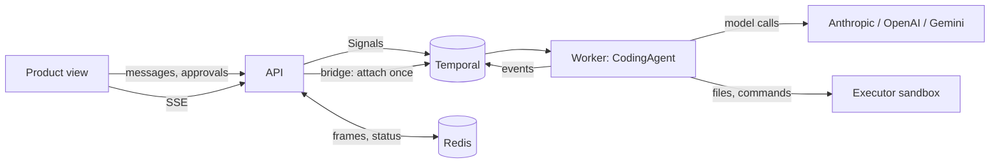

# Advanced AI Agent

A coding agent built on the official Temporal Agent Harness. It fixes a bug in a real repo, survives a worker crash in the middle of the test run, and waits for a human to approve the commit.

What's in it:

- **[`temporal-agent-harness`](https://pypi.org/project/temporal-agent-harness/) 0.7.0** for the agent loop: turns, tools, approvals, events, subagents, Code Mode and browser callbacks. The few gaps it has (interrupt, continue-as-new, heartbeats) are filled in one module, [`agent/harness_ext.py`](simple_chat_agent/agent/harness_ext.py).
- **[Pydantic AI's Temporal integration](https://ai.pydantic.dev/durable_execution/temporal/)** with Anthropic, OpenAI and Gemini. You can switch provider between turns and keep the history.
- **A sandboxed workspace.** The agent reads, searches and edits code, runs commands and tests, and commits locally, inside a Bubblewrap sandbox with no credentials.
- **Approvals** with four postures, including an auto mode where a judge approves routine calls and sends the rest to you. The gate fails closed.
- **Durability you can see.** A worker crash shows what Temporal kept and what it repeated. Messages and approvals sent while no worker is running land in Temporal as [Signals](https://docs.temporal.io/sending-messages#sending-signals) and apply when a worker returns.
- **[Worker Versioning](https://docs.temporal.io/production-deployment/worker-deployments/worker-versioning)** with PINNED workflows, and [continue-as-new](https://docs.temporal.io/workflow-execution/continue-as-new) for long sessions.
- A product view in the buildkit design language, the harness console one click away, and Temporal UI links on every session.
- Extras: MCP servers (local only), Code Mode scripts, `ask_user` and `pick_files` cards, and provider web search with a sources list.

## How it works



| Component | What it does | When it's down |
|---|---|---|
| Worker (`CodingSessions`, `CodingAgent`, `Explorer`, `Reviewer`) | Runs each session as a workflow. Model calls and workspace tools are activities. | The UI keeps working from Redis. New messages and approvals wait in Temporal. A banner says the worker isn't answering. |
| API | Auth, the harness transport routes, the Signal front door, the bridge that copies agent events into Redis, uploads and the console | The UI is unavailable; workflows carry on. |
| Redis (AOF) | The session's event log, status, leases and spend counters | Attach falls back to Temporal. New turns stop (spend checks fail closed). |
| Executor | Runs commands and file operations in a per-session workspace | Tools retry; the Terminal says the sandbox isn't answering. |
| Temporal | Durable state, the event stream, versioning | Everything waits. |

A turn: the browser posts a message; the API sends it as a Signal; the workflow opens a turn and calls the model in a heartbeating activity. Each tool call passes the approval gate (deterministic rules, then the judge or you), then runs as an activity. The bridge attaches to the workflow once per session and writes each event to Redis, and every open tab reads from there. Nothing on a browser path issues a Query.

When a worker dies mid-turn, the model call's heartbeat stops, Temporal retries it on another worker, and a running test command reattaches to the job that is still running in the sandbox. The transcript then shows what was kept and what was repeated.

## Prerequisites

- Python 3.12 and [uv](https://docs.astral.sh/uv/)
- Node 22 (for the web app)
- Docker Desktop (for the sandbox executor)
- The [Temporal CLI](https://docs.temporal.io/cli)
- `redis-server`
- The AWS CLI with access to the demo account's Secrets Manager (for the shared LLM keys), or your own keys

## Run it locally

```sh
uv sync
scripts/dev-secrets.sh        # pulls the Anthropic, OpenAI and Gemini keys into .env.local (mode 600, never printed)
make dev-stack                # prints the commands below with this repo's paths
```

Then start each piece in its own terminal:

1. Redis: `mkdir -p .simple_chat_agent && redis-server --port 6390 --appendonly yes --dir .simple_chat_agent`
2. Temporal: `temporal server start-dev --port 7244 --ui-port 8244 --db-filename dev.db --search-attribute CodingAgentOwner=Keyword --search-attribute UserEmail=Keyword`
3. The executor: `make executor-image`, then the `docker run` line that `make dev-stack` prints. Check it with `curl -s 127.0.0.1:8083/healthz`. Add `WORKSPACE_EXECUTOR_TOKEN=<any random value>` to `.env.local` first; the worker, API and executor share it.
4. The worker: `make dev-worker`
5. The API: `make dev-api` (it runs without provider keys)
6. The web app: `make web`, then open http://127.0.0.1:8000/ and sign in as `demo` / `demo`.

| Command | What it does |
|---|---|
| `make web` | Builds the product view; the API serves it at `/` |
| `make web-dev` | Vite with live reload, proxying `/api` and `/console` to the API |
| `make dev-worker` | Runs the worker on Task Queue `coding-agent-dev` |
| `make dev-api` | Runs the API on 8000 with local login |
| `make crash-worker` | SIGKILLs the dev worker (the demo's crash) |
| `make image`, `make executor-image` | Build the app image and the executor image |
| `make gen` | Regenerates the web app's types from the agents' schemas |

Tests: `.venv/bin/python -m unittest discover -s tests` for Python (Redis on 6390; some suites also want the dev server on 7244), and `npm test` and `npm run typecheck` in `simple_chat_agent/web`.

## Demo script (7 minutes)

One session, from **New demo session**. The seed is a small Python service with one real bug and a test suite that takes about 20 seconds.

| Time | Do | What you'll see |
|---|---|---|
| 0:00 | Open the product view. Posture **Auto mode**, model Claude. | |
| 0:40 | Send: "test_refund fails. Find the cause, fix it, run the tests, commit." | The plan fills in. Two explorers run in parallel, nested in the transcript. |
| 1:50 | | The fix appears as an inline diff. The judge approves `pytest`, and the Terminal streams. |
| 2:40 | `make crash-worker` during the test run, then `make dev-worker`. | A yellow banner. In Temporal UI, the pending activity. Then a recovery divider ("Worker lost at …. Kept: … Repeated: …") and the tests go green. |
| 4:10 | | `git_commit` goes to you, not the judge. Reload the page: the card is still there. Approve. |
| 4:50 | Switch the model to GPT. Send: "Review the diff." | The Reviewer subagent returns a structured review. |
| 5:40 | Click **Harness console**. | The same session as the harness records it: the raw loop. |
| 6:30 | | Close on the meters: tokens in and out, the share read from the provider cache, recoveries, and the work kept after the worker loss. |

### Extras (local)

Run these on a fresh session after the core script. Each one takes a minute or two.

| Feature | Setup | Do | What you'll see |
|---|---|---|---|
| MCP | `.venv/bin/python -m tests.fixtures.mcp.echo_server --port 8765`, and add `AGENT_MCP_LOOPBACK_PORTS=8765` to `.env.local` before starting the worker and API. | Open **MCP servers**, add `local-echo` at `http://127.0.0.1:8765/mcp`, start a new session, and ask the agent to echo something. | "Connected · 2 tools". An approval card for `local-echo · echo`, then its result in the transcript and the console. |
| Code Mode | | "Read every file under src/ in one script and summarize them." | One **Approve script** card; the script's host calls nest under it. |
| `ask_user` | | "Ask me which file to start with before you change anything." | A choice card in the decision dock. It survives a reload. |
| `pick_files` | | "Ask me for a CSV and add up its numbers." | A file picker; the upload lands in `uploads/` and the agent reads it. |
| Web search | Turn on **Web search** in the composer. | Ask a question about something recent. | A sources list under the reply. Off by default. |

## Cost per demo run

Measured on the local stack, one run each:

| Run | Input tokens | Output tokens |
|---|---|---|
| Core script | about 125k | about 5k |
| Extras walkthrough | about 155k | about 1.5k |

About 70% of the input is read from the provider's cache, which providers bill at a discount. The meters strip shows the live numbers for each session. In the catalog, per-session, per-user-per-day and global spend caps stop a turn before it goes over (see [docs/catalog.md](docs/catalog.md#spend-caps)).

## More

- [docs/catalog.md](docs/catalog.md): the always-on catalog deployment (environment, Task Queue and Worker Deployment, NetworkPolicy, S3 lifecycle).
- [docs/CUTOVER.md](docs/CUTOVER.md): moving the catalog from the old chat app.
- [docs/SECURITY-CHECKLIST.md](docs/SECURITY-CHECKLIST.md): each safety rule and the test that proves it.
- [docs/local-development.md](docs/local-development.md): environment variables and troubleshooting.
- [`basic_file_agent/`](basic_file_agent/README.md): a minimal agent on the same harness, about 150 lines.
- [docs/PRD.md](docs/PRD.md): requirements and decisions.

## Notes

- The harness is pre-1.0 and pinned at 0.7.0. `harness_ext.py` uses a few of its private internals; `tests/test_harness_ext.py` fails if they move.
- MCP servers and the "Never ask" posture are local only. In the catalog, MCP is off and the judge can approve only reads and file edits.
- There is no patching. Workers are versioned and workflows are PINNED; a code change ships as a new Worker Deployment Version.
